# ccwatermelon

A Claude Code statusline built as a companion to [Burnrate](https://github.com/axelhamil/burnrate): Burnrate's band above the prompt owns the quotas, projections, budget and cost, ccwatermelon owns everything else. Who you are (mood, project, branch, model), how full the conversation is, and how the session is going, on 1 to 3 lines, in your terminal's own 16 colours.



One session, from the first prompt to the compaction threshold. The mood turns, the context gauge fills and changes colour, and the segments flow onto more lines as they appear.

Every preview on this page is drawn by the real renderer (`bun run previews`), with a sample dark theme: in your terminal the colours are the ones of your theme.

## Make it yours



Segments switched on or off, priorities, a stricter context alert: one JSONC file, per user or per project. The line above each preview is the config that produced it.



The segments fill line 1 first and flow onto the next ones as the terminal narrows, up to 3 lines. When even 3 lines are not enough, the lowest priority segments leave first, and long names are cut with an ellipsis.



`bun run config` opens the editor: every key press redraws the real status line above the list. `w` plays the width sweep and `p` the pressure sweep, so you see what a priority or a threshold does before saving it.

## Reading the line

```
(•‿•)   ccwatermelon   feat/melon-config* #128 ✓ +142 -38   Opus 4.7   effort high   conv 72%⡟ ↓52k   cache 41%
time 18m   lines +142 -38   worktree melon
```

The style is Burnrate's: labels are dim, values are in the default colour, and only a status gets a colour, green while all is well, yellow for a warning, red for an alert. Segments are 3 spaces apart.

- `conv 72%⡟ ↓52k`: the conversation is at 72% of the compaction threshold, 52k tokens before Claude Code compacts it. Past the threshold it reads `+272k`, the amount already over.
- `cache 41%`: the cache hit rate, shown only below 70%, when context is being paid for at full price.
- `feat/melon-config* #128 ✓ +142 -38`: the branch, `*` when dirty, its pull request and review state, and the uncommitted diff.
- `lines +142 -38`: the lines added and removed by Claude over the session, distinct from the git diff.

## Requirements

- **Bun** (runtime, no other one is supported; CI runs the version in `.bun-version`)
- A terminal with the 16 basic ANSI colours (any terminal): the line follows your terminal theme
- `git` on `PATH` (optional: without it, the branch segment simply shows `no-git`)
- [Burnrate](https://github.com/axelhamil/burnrate) for quotas and cost (optional, ccwatermelon no longer shows them)

## Installation

```bash
git clone https://github.com/axelhamil/ccwatermelon.git ~/.claude/scripts/ccwatermelon
cd ~/.claude/scripts/ccwatermelon
bun install
```

Any directory works, just keep the path in `statusLine.command` below in sync.

In `~/.claude/settings.json`:

```json
{
  "statusLine": {
    "type": "command",
    "command": "bun ~/.claude/scripts/ccwatermelon/src/index.ts",
    "padding": 0,
    "refreshInterval": 1
  },
  "subagentStatusLine": {
    "type": "command",
    "command": "bun ~/.claude/scripts/ccwatermelon/src/subagents.ts"
  }
}
```

Both extras are optional:

- `refreshInterval` re-runs the line every second on top of Claude Code's own events. The mood blinks and a context gauge past its threshold pulses without waiting for the next message. Leave it out and the line only moves when Claude Code redraws, at no idle cost.
- `subagentStatusLine` draws the row of each running subagent in the same style: status, name, model, tokens with their recent trend, elapsed time and task, aligned in columns.

```
⠋ explorer            haiku 4.5   48k  ⣀⣠⣤⣴⣶⣶⣿⣿   3m  Map every caller of the billing webhook handl…
✓ feature-dev:code-…  opus 4.5   131k    ⢀⣠⣤⣶⣿⣿  10m  Review the retry policy diff
✗ docs                sonnet      920         ⣸   4m  Read the Stripe idempotency key documentation
```

The directory, the branch and the pull request are clickable links (OSC 8) in terminals that support them, such as Kitty, WezTerm or iTerm2. If they show but do not open, start Claude Code with `FORCE_HYPERLINK=1`. Turn them off with the `links` segment.

## Segments

The segments are laid out in this order, filling line 1 first.

| Segment | Default | Why |
|---|---|---|
| `mood` | always on | ASCII mood that reacts to the context pressure, the first warning signal, before you even read a number |
| `dir` / `git` / `model` | always on | identity: directory, branch + diff (`+ins -del`), active model, the essential baseline |
| `pullRequest` | on, silent if absent | the open pull request of the branch and its review state: `#128 ✓` approved, `●` pending, `✗` changes requested, `◌` draft |
| `effort` | on, silent if absent | reasoning effort of the session (`effort high`), right after the model |
| `fastMode` | on, silent if off | `↯ fast` while fast mode is on |
| `thinking` | **off** | `✦ thinking` while extended thinking is on |
| `contextGauge` | on | conversation context pressure **measured against the real compaction threshold** (not the raw window, see below), one braille glyph |
| `cache` | on if < 70% | cache hit rate, below 70% context is being paid for at full price |
| `duration` | on | how long the session has been running (`time 18m`) |
| `linesChanged` | on, silent if zero | total lines added/removed over the session (`cost.total_lines_added/removed`), distinct from the git diff |
| `worktree` | on, silent if absent | current git worktree name (`workspace.git_worktree`), useful in multi-branch dev |
| `vimMode` | on, silent if absent | current vim mode (`vim.mode`), only if the hook provides it |
| `agentName` | on, silent if absent | name of the active sub-agent (`agent.name`) |
| `outputStyle` | on, hidden if "default" | current output style, only if it differs from the default |
| `sessionName` | **off** | Claude Code session name, noisy by default (often auto-generated), enable if useful |
| `ccVersion` | **off** | Claude Code CLI version, occasionally useful to spot an update, enable as needed |
| `night` | on | `☾` between 1am and 5am local time, a quiet reminder that it's late |
| `motion` | on | everything that moves with the clock: blink and pulse. Switch it off for a still line |
| `links` | on | makes directory, branch and pull request clickable, switch it off if your terminal prints the escape codes |

Every optional segment carries a **priority**. The line never takes more
than 3 rows: when the enabled segments do not fit in 3, the lowest
priority ones disappear first. Mood, directory, branch and model have no
priority, they always stay.

## Configuration

Format of choice: **JSONC** (JSON + `//` and `/* */` comments), with no
dedicated parsing dependency (a simple comment strip is enough before
`JSON.parse`), consistent with claude-powerline and ccstatusline, and
zero risk of pulling a TOML lib into the render path.

### Resolution cascade

1. `$CLAUDE_CONFIG_DIR/ccwatermelon/config.jsonc` (if the variable is set)
2. `~/.config/ccwatermelon/config.jsonc`
3. `./.ccwatermelon.jsonc` (project file, in the session's `cwd`), **overrides** the previous levels, key by key

Each file is validated independently with **zod** (`safeParse`): an
invalid file (malformed JSON, out-of-range threshold, wrong type) is
ignored with a warning on **stderr** (never stdout, that would break the
display), and the statusline falls back to defaults. No file at all =
current behavior unchanged.

### Reference

```jsonc
{
  "thresholds": {
    // One number drives the context gauge: it turns red and its glyph pulses
    // above it, it turns yellow 20 points below, and the mood panics halfway
    // between it and 100.
    "compactAlert": 85,            // % of the compaction threshold
    "compactionReserveRatio": 0.92 // fraction of the window reserved before auto-compact
  },

  "segments": {
    "duration": { "enabled": false },
    "ccVersion": { "enabled": true },
    "worktree": { "priority": 12 }
  }
}
```

- `enabled`: `true`/`false`, hides the segment
- `priority`: number, higher means it disappears last under reduced width

An invalid config (e.g. `compactAlert: 500`) never breaks the render: it
is rejected as a whole with a message on stderr, and defaults apply. Keys
from older versions (`theme`, `colors`, `fiveHourAlert`, `sevenDayAlert`,
a segment's `line`, removed segments such as `today` or `pace`) are
ignored.

### Environment variables

| Variable | Effect |
|---|---|
| `CCWATERMELON_WIDTH` | forces the terminal width (otherwise `process.stdout.columns`, then `$COLUMNS`, which Claude Code sets to the real terminal width, then 80) |
| `CLAUDE_CONFIG_DIR` | where `settings.json` is read (default `~/.claude`), and adds `$CLAUDE_CONFIG_DIR/ccwatermelon/config.jsonc` at the top of the config cascade |

Tests point it and `HOME` at temporary directories so that `bun test` never reads real data. ccwatermelon writes nothing to disk at render time.

## Interactive CLI

```bash
bun run config
# or, once the package is linked: ccwatermelon-config
```

A full-screen editor with the real status line on top, redrawn at every
key press through the same `render()` function used in production.

| Key | Effect |
|---|---|
| `↑` `↓` | move between the context alert and the segments |
| `←` `→` | adjust the threshold or change a segment's priority (`[` `]` move a threshold by 5) |
| `space` | switch a segment on or off |
| `r` | put the row back to its default |
| `w` | width demo: the preview narrows to 34 columns and back, so you see what your priorities drop first |
| `p` | pressure demo: the context sweeps from empty to full, so you see where your threshold changes colour and mood |
| `s` / `q` | save and exit / exit, asking twice when there are unsaved changes |

The threshold slider shows its three zones (warning, alert, panic) as you
drag it. Set `NO_MOTION=1` to turn the demos and the slider easing off.
Saves to
`~/.config/ccwatermelon/config.jsonc` as plain JSON, so comments written
in that file by hand are lost on save.

## Security & robustness

A statusline is an unusual attack surface: it renders untrusted content
(directory names, branch names) into a terminal, on every single message.
The hardening here is deliberate.

- **Terminal injection is neutralised.** Every externally-sourced label ,
  directory, branch, worktree, session name, agent name, output style, vim
  mode, model, is stripped of control characters before rendering
  (`src/terminal/sanitize.ts`). Without this, a cloned repository containing a
  directory whose name embeds a raw `ESC` could emit an OSC sequence to
  rewrite your window title, a CSI to clear the screen, or a bare `CR` to
  hide the start of the line. Git rejects control characters in refnames,
  but nothing stops a directory from carrying them.
- **No shell.** Git runs through `Bun.$` with escaped interpolation, never
  `sh -c`.
- **A malformed payload degrades one segment, not the whole line.** The
  stdin payload goes through a zod schema where every field fails on its
  own (`src/statusline/payload.ts`): a string where a number belongs, a negative
  duration, or `1e308` is rejected rather than clamped. `settings.json` and
  the config files are validated the same way.
- **One runtime dependency** (`zod`), installed locally. Nothing is
  fetched at render time, so there is no `npx @latest` executing
  freshly-downloaded code on every message.
- **Git is never blocked.** Status calls run with `--no-optional-locks`, so
  a render never takes `index.lock` under a commit you are making.

## Width & responsiveness

Width is resolved via `CCWATERMELON_WIDTH` → `process.stdout.columns` →
`$COLUMNS` → `80`, never via `tput` (that's exactly the bug that breaks
ccstatusline on Windows by creating a `null` file).

Visual width calculation (`src/terminal/width.ts`) is not `string.length`: ANSI
codes are ignored, emoji and CJK characters count as double-width,
combining marks and variation selectors count as zero, and Nerd Font
glyphs (Unicode private-use plane) count as single-width, matching how
they actually render in a patched terminal.

The segments are laid out in order, 3 spaces apart: line 1 is filled
first, a segment that does not fit starts the next line, and there are
never more than 3 lines nor an empty one. When the enabled segments need
more than 3 lines, the lowest priority ones disappear one by one until
they fit. Mood, directory, branch and model always stay, and a directory
or branch name too long for the terminal is cut with an ellipsis.

## Design rationale

- **No block progress bars, no sparklines on the line.** A single braille
  glyph (`⡇⡄⣿…`) carries the context gauge in one character instead of
  eight, and its colour (green, yellow, red by threshold) carries the rest.
- **The terminal's colours, not ours.** Only the 16 basic ANSI colours are
  used, so the line follows your terminal theme, light or dark, like
  Burnrate's band right above it.
- **Motion is tied to the wall clock, not to a loop.** The script never
  stays alive: every render picks its frame from the current second, so
  each animation is designed for one frame per second, the fastest
  Claude Code allows. The mood blinks one second in five and the glyph of
  a context gauge past its alert threshold alternates between red and dim.
  With `refreshInterval` they run continuously, without it they advance
  whenever Claude Code redraws. The `motion` segment turns them off.
- **Context is measured against the compaction threshold, not the raw
  window.** `contextGauge` compares tokens used to the real auto-compact
  threshold, not `context_window_size`: the `autoCompactWindow` token
  count from `settings.json` when it is set, capped at
  `context_window_size` × `compactionReserveRatio`, and that cap alone
  otherwise. That's the limit that
  actually matters day to day: at 90% of the raw window but 60% of the
  compaction threshold, there's still plenty of headroom, showing the
  first number would create a false alarm.
- **Never any network nor disk write on the render path.** Claude Code
  kills the script if a new render is triggered while it's still running:
  a blocking call there is a bug, not just slowness.
- **No duplicate of Burnrate.** Quotas, projections, daily budget and
  dollar costs live in Burnrate's band, computed from the real usage
  history. ccwatermelon used to show them too, and two answers to the same
  question on screen is one too many.

## Comparison with the ecosystem

|  | ccwatermelon | ccstatusline (sirmalloc) | CCometixLine | claude-powerline |
|---|---|---|---|---|
| Config | JSONC + zod, 3-level cascade | JSON + React/Ink TUI | TOML + Rust TUI | JSON, 3-level cascade |
| Widgets | ~20, sized for solo use | 50+ | built-in themes (minimal/gruvbox/nord/powerline) | 4 styles, several themes |
| Perf | no transcript parsing, no network on the render path | 60-80% CPU documented (reparses the whole JSONL on every render) | native Rust, fast | no dependency, lightweight |
| Responsive | flows over 1 to 3 lines + per-segment priority | width detection with a known `tput`/Windows bug | not documented | CSS-Grid-style grid with breakpoints, more advanced on this specific point |
| Bars/sparklines | deliberately absent | yes (blocks and gradients) | yes | yes |
| Setup | zero dependency on the render path | `npx -y @latest` on every message (documented supply-chain risk) | compiled binary | zero dependency |

What we do better: latency, readable gauges without visual noise, config
that never breaks the render, and it leaves quotas and cost to Burnrate. What others do
better: ccstatusline has substantially more widgets and an established
theme ecosystem; claude-powerline has a more mature responsive layout
engine (CSS-Grid-style breakpoints, whereas we settle for a per-segment
priority system); CCometixLine has a config TUI with a live preview
compiled in Rust, where ours is a Bun raw-mode screen.

## Development

```bash
bun test                               # full suite
bun run lint                           # biome, lint + format check
bun run typecheck                      # strict typecheck
bun run knip                           # dead code and unused dependencies
bun run config                         # config editor with live preview
bun run previews                       # regenerate the animated README previews
```

Commits follow Conventional Commits (commitlint on `commit-msg`), and the
`pre-commit` hook runs the four checks above. CI runs them again on every
pull request and push to `main`, checks that the committed previews match the
renderer, and on `main` lets semantic-release decide the version and
publish the GitHub release from the commit history.

Tests isolate everything they touch (`CLAUDE_CONFIG_DIR`, `HOME`) in
temporary directories, never real data.
